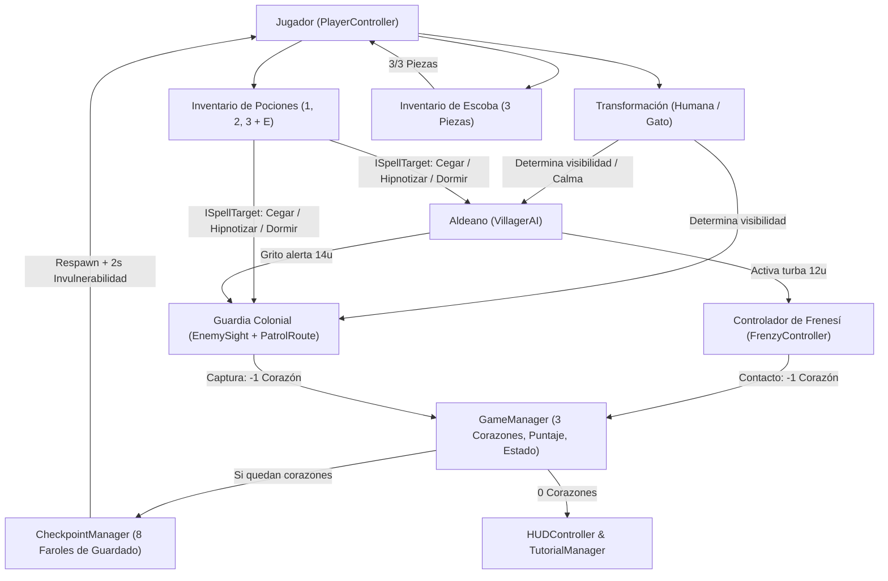

# Brujas de Salem — Documentación General del Juego

**Motor:** Unity 6 (6000.3 LTS) — 2D URP  
**Género:** Plataformas 2D, Sigilo Táctico y Acción Mágica  
**Proyecto:** `DV_Brujas_De_Salem`

---

## 1. Descripción General del Juego

**Brujas de Salem** es un videojuego de plataformas y sigilo en 2D ambientado en la época colonial de Salem. El jugador controla a una joven bruja que debe escapar de la aldea evitando la persecución de los guardias coloniales y la histeria colectiva de los aldeanos.

El objetivo principal del **Nivel 1 (Tutorial Guiado — ~232 unidades divididas en 9 zonas)** es **reunir las 3 partes de la escoba mágica** (*Rama*, *Paja* y *Cuerda*) distribuidas a lo largo del escenario para ensamblar su escoba, desbloquear la habilidad de vuelo y cruzar el gran abismo final hasta alcanzar el **Portón de Salida (`LevelGoal`)**, conservando sus **3 corazones de vida**.

---

## 2. Controles del Juego

El sistema de entrada está centralizado en [`ControlsMap.cs`](../Assets/Scripts/Core/ControlsMap.cs), lo que garantiza consistencia en todos los letreros del mundo, avisos del HUD y paneles de tutorial:

| Acción | Tecla / Entrada Principal | Entrada Alternativa | Condición de Uso |
| :--- | :--- | :--- | :--- |
| **Moverse (Izquierda / Derecha)** | `A` / `D` | Flechas `←` / `→` | Siempre activo en estado `Playing` |
| **Saltar** | `Espacio` | — | En el suelo o dentro de *Coyote Time* (`0.1s`) |
| **Transformarse (Humana ↔ Gato)** | `T` | — | Cooldown de `0.75s`; requiere espacio libre para volver a forma humana |
| **Activar / Desactivar Vuelo** | `F` | `Fire2` | Requiere haber reunido las **3 piezas de la escoba** y tener energía ($\ge 5\%$) |
| **Volar (Subir / Bajar)** | `W` / `S` | Flechas `↑` / `↓` | Mientras el modo de vuelo está activo |
| **Seleccionar Poción** | `1`, `2` o `3` | `Keypad 1`, `2`, `3` | `1`: Cegar \| `2`: Hipnotizar \| `3`: Dormir |
| **Lanzar Poción** | `E` | `Clic Izquierdo` | Solo en **forma humana**, con cargas disponibles y cooldown de `0.5s` |
| **Confirmar / Cerrar Tutorial** | `Enter` | `Clic Izquierdo` | Cuando hay un panel de tutorial activo en pantalla |
| **Pausar / Reanudar Partida** | `Esc` | — | Durante la partida (deshabilitado mientras se lee un tutorial) |

---

## 3. Acciones del Jugador y Efectos que se Generan

Cada entrada del jugador desencadena una cadena de eventos físicos, visuales, sonoros y de interfaz:

### 3.1. Movimiento y Salto ([`PlayerController.cs`](../Assets/Scripts/Player/PlayerController.cs))
* **Desplazamiento horizontal con inercia ajustada:** Velocidad base de `6 u/s` en forma humana (`7.8 u/s` en forma de gato gracias al multiplicador de `1.3x`), con aceleración (`45 u/s²`), desaceleración (`55 u/s²`) y control aéreo al `85%`.
* **Salto de altura variable:** Alcanza hasta `2.8 u` manteniendo `Espacio`. Si se suelta antes de llegar al ápice, la velocidad vertical se recorta (`x0.45`) para permitir saltos cortos y precisos.
* **Asistencias de plataformeo (*Game Feel*):**
  * **Coyote Time (`0.1s`):** Permite saltar brevemente tras dejar el borde de una plataforma.
  * **Jump Buffer (`0.1s`):** Registra la pulsación de salto instantes antes de tocar el suelo para ejecutarlo automáticamente al aterrizar.
  * **Gravedad de caída mejorada (`1.5x`):** Hace que el descenso sea ágil y evita la sensación de flotación excesiva.
* **Acciones generadas:** Actualiza parámetros del `Animator` (`Speed`, `IsGrounded`, `VerticalVelocity`), invierte el sprite según la dirección (`flipX`) y reproduce el sonido de salto en [`AudioManager`](../Assets/Scripts/Core/AudioManager.cs).

### 3.2. Transformación Mágica: Forma Humana ↔ Forma de Gato ([`TransformationManager.cs`](../Assets/Scripts/Player/TransformationManager.cs))
Al pulsar `T`, la bruja alterna entre sus dos formas con un enfriamiento de `0.75s`:

| Propiedad | Forma Humana | Forma de Gato |
| :--- | :--- | :--- |
| **Tamaño del Collider** | `0.6 x 1.6 u` | `0.8 x 0.5 u` (permite cruzar túneles estrechos de `1.05 u`) |
| **Velocidad de Movimiento** | `6.0 u/s` (`1.0x`) | `7.8 u/s` (`1.3x`) |
| **Detección por Guardias** | Siempre detectable dentro del cono de visión | **Indetectable dentro de maizales (`HideoutZone`)**; fuera de ellos, solo detectable a muy corta distancia ($\le 2.5\text{ u}$) |
| **Detección por Aldeanos** | Detectable a `6.5 u`; provoca gritos y frenesí | **Completamente ignorada**; si ya había frenesí activo, **lo cancela inmediatamente** |
| **Uso de Pociones y Vuelo** | Permitido | **Bloqueado** (cancela el vuelo automáticamente al transformarse en gato) |

* **Validación de espacio al volver a forma humana:** Antes de crecer a `1.6 u` de altura, lanza un `Physics2D.OverlapBoxAll`. Si está dentro de un tronco hueco o bajo un techo bajo ([`CatOnlyPassage`](../Assets/Scripts/Level/CatOnlyPassage.cs)), impide la transformación y muestra en el HUD: *"Eres muy grande para pasar"*.
* **Acciones generadas:** Dispara partículas de humo (`smokeEffect`), reproduce sonido de transformación, intercambia el `RuntimeAnimatorController` y emite el evento `OnTransformed(bool isCat)`.

### 3.3. Sistema de Pociones Arrojables ([`PotionInventory.cs`](../Assets/Scripts/Player/PotionInventory.cs) y [`PotionProjectile.cs`](../Assets/Scripts/Level/PotionProjectile.cs))
* **Recolección ([`PotionPickup.cs`](../Assets/Scripts/Level/PotionPickup.cs)):** Frascos flotantes en el escenario que suman `+1` carga al inventario del [`GameManager`](../Assets/Scripts/Core/GameManager.cs) (máximo **3 cargas** por tipo).
* **Selección (`1`, `2`, `3`) y Lanzamiento (`E` / `Clic Izquierdo`):** Engendra un proyectil con trayectoria parabólica (`velocidad X = 7 u/s`, `velocidad Y = 6 u/s`, `gravedad = 2.2`).
* **Impacto y Salpicadura en Área (`1.6 u` de radio):** Al chocar contra el suelo o un enemigo, instancia una animación de salpicadura de 4 fotogramas (`SplashAnimator`) y aplica el efecto a todos los objetivos que implementen [`ISpellTarget`](../Assets/Scripts/Core/ISpellTarget.cs) (guardias y aldeanos) dentro del radio:

| Tecla | Poción | Duración Base | Efecto en Guardias ([`PatrolRoute`](../Assets/Scripts/Enemies/PatrolRoute.cs)) | Efecto en Aldeanos ([`VillagerAI`](../Assets/Scripts/Enemies/VillagerAI.cs)) |
| :---: | :--- | :---: | :--- | :--- |
| **`1`** | **Cegar (`Blind`)** | `5.0 s` | Suprime la visión (cono gris), cancela alertas, se detiene `0.8s` y camina lento (`45%`) con icono de ojos vendados. | Cancela alerta/frenesí y camina confundido al `35%` de velocidad con icono sobre la cabeza. |
| **`2`** | **Hipnotizar (`Hypnotize`)** | `4.0 s` | Suprime la visión (cono morado) y obliga al guardia a caminar en la dirección del impacto (`90%` vel.) con icono de espiral. | Camina hipnotizado en la dirección del lanzamiento (`80%` vel.) sin detectar a la bruja. |
| **`3`** | **Dormir (`Sleep`)** | `6.0 s` | Apaga por completo el cono de luz, inmoviliza al guardia (`velocidad = 0`) y muestra el icono `Zzz`. | Inmoviliza por completo al aldeano y detiene cualquier grito o persecución. |

* **Restricciones y avisos:** Si se intenta lanzar en forma de gato, muestra *"¡No puedes lanzar pociones convertida en gato!"*. Si no hay cargas de la poción seleccionada, el contador parpadea en rojo en el HUD (`FlashEmptyCharges`) y muestra *"¡No te quedan cargas de esa poción!"*.

### 3.4. Ensamblaje de la Escoba y Vuelo ([`BroomInventory.cs`](../Assets/Scripts/Player/BroomInventory.cs))
* **Recolección de piezas ([`Collectible.cs`](../Assets/Scripts/Level/Collectible.cs)):** Existen 3 piezas únicas en el nivel: **Rama (`Branch`)**, **Paja (`Straw`)** y **Cuerda (`Rope`)**. Cada una otorga `+100 puntos` y actualiza el widget visual de progreso de la escoba ([`BroomHUD`](../Assets/Scripts/UI/BroomHUD.cs)).
* **Desbloqueo del vuelo:** Al recolectar la 3.ª pieza, `BroomInventory` habilita `CanFly = true` en `PlayerController`, reproduce partículas de completado, activa la barra de energía de vuelo en el HUD y despliega el tutorial `tip_escoba_completa`.
* **Mecánica de vuelo (Gravedad Cero):**
  * Pulsar `F` desactiva la gravedad (`gravityScale = 0`) y permite desplazamiento libre en 8 direcciones (`6 u/s` horizontal, `5 u/s` vertical).
  * **Energía limitada:** Dura un máximo de **4 segundos** de vuelo continuo (~`20.4 u` de alcance horizontal). Se consume en tiempo real y se recarga automáticamente al tocar el suelo (`+60%` por segundo).
  * **Aterrizaje automático o voluntario:** El vuelo se cancela al agotarse la energía, al pulsar `F` de nuevo, al transformarse en gato, o al tocar el suelo presionando hacia abajo (`S` / `↓`).

---

## 4. Cómo Funciona el Mundo y los Sistemas del Juego

### 4.1. Inteligencia Artificial de los Guardias ([`EnemySight.cs`](../Assets/Scripts/Enemies/EnemySight.cs) y [`PatrolRoute.cs`](../Assets/Scripts/Enemies/PatrolRoute.cs))
1. **Cono de visión dinámico (`Raycasting 2D`):** Cada guardia proyecta un abanico de **30 rayos** en un ángulo de `60°` con alcance de `7 unidades`, renderizado en pantalla mediante un `Mesh` dinámico. Los muros y el suelo cortan los rayos (no ven a través de obstáculos).
2. **Máquina de estados del farol (`AlertState`):**
   * **Calma (Amarillo):** Patrulla entre sus *waypoints* (`2.2 u/s`) respetando bordes de plataformas y muros.
   * **Sospecha (Naranja):** Al detectar a la bruja, el guardia se detiene y mira hacia ella. Si la bruja permanece visible durante `1.2 segundos`, pasa a **Alerta**.
   * **Alerta / Persecución (Rojo):** El guardia corre hacia la bruja a `3.8 u/s`. Si pierde de vista al jugador durante `2.0 segundos` (por distancia, obstáculo o porque se escondió como gato en un maizal), regresa a su ruta de patrulla.
   * **Captura:** Si el guardia se acerca a $\le 1.2\text{ u}$ de la bruja en estado de alerta, dispara el evento de captura.
3. **Resolución de Captura ([`CaptureListener.cs`](../Assets/Scripts/Core/CaptureListener.cs)):**
   * Resta **1 corazón** a la bruja.
   * Si aún le quedan corazones, teletransporta a la bruja al último **Checkpoint** activado, reinicia al guardia a su primer *waypoint* en estado de calma y otorga **2 segundos de invulnerabilidad**.

### 4.2. Inteligencia Artificial de los Aldeanos y Sistema de Frenesí ([`VillagerAI.cs`](../Assets/Scripts/Enemies/VillagerAI.cs) y [`FrenzyController.cs`](../Assets/Scripts/Enemies/FrenzyController.cs))
A diferencia de los guardias, los aldeanos tienen un comportamiento impredecible basado en **3 patrones aleatorios de paseo (`WanderPattern`)**:
* `WalkAndReturn`: Camina un tramo, hace una pausa y da la vuelta.
* `LookAround`: Camina hasta un punto, se detiene a mirar a ambos lados y continúa.
* `ShortStops`: Avanza con pasos cortos y pausas frecuentes.

**Reacción en cadena al ver a la bruja (solo en forma humana a $\le 6.5\text{ u}$):**
1. **Aviso (`Notice` — `0.5s`):** Muestra el icono `!` sobre su cabeza. Si la bruja se transforma en gato en esta ventana, el aldeano se calma.
2. **Grito de Alerta (`Scream` — `2.0s`):** Reproduce el grito de alarma y **pone en estado de Alerta/Persecución a todos los guardias en un radio de `14 unidades`**.
3. **Ataque Frenético (`Frenzy` — `8.0s`):** Activa el [`FrenzyController`](../Assets/Scripts/Enemies/FrenzyController.cs), que recluta hasta **5 aldeanos en un radio de `12 unidades`** para correr tras la bruja a `4.2 u/s`. El HUD muestra una **viñeta roja pulsante** y un icono de alarma.
4. **Daño y formas de terminar el Frenesí:**
   * Si un aldeano en frenesí alcanza a la bruja ($\le 1.0\text{ u}$), le quita **1 corazón** y entra en enfriamiento (`Cooldown` de `5s`).
   * El frenesí se cancela inmediatamente si la bruja **se transforma en gato (`T`)**, se esconde en un maizal, se aleja a más de `20 unidades` o neutraliza a los aldeanos con pociones.

### 4.3. Salud, Invulnerabilidad, Checkpoints y Zonas del Nivel
* **Sistema de 3 Corazones ([`HealthManager.cs`](../Assets/Scripts/Player/HealthManager.cs) y [`GameManager.cs`](../Assets/Scripts/Core/GameManager.cs)):**
  * Toda fuente de daño (captura de guardia, golpe de aldeano en frenesí o caída al vacío en [`KillZone`](../Assets/Scripts/Level/KillZone.cs)) resta **1 corazón**.
  * Al recibir daño sin morir, [`PlayerInvulnerability`](../Assets/Scripts/Player/PlayerInvulnerability.cs) protege a la bruja durante **2.0 segundos** con un parpadeo visual a `8 Hz`.
  * Los ítems [`HeartPickup`](../Assets/Scripts/Level/HeartPickup.cs) curan `+1 corazón` si la salud no está al máximo.
  * Al perder los 3 corazones, se activa el estado `GameOver` y se despliega el panel *"La hoguera te alcanzó…"*.
* **Sistema de Checkpoints ([`Checkpoint.cs`](../Assets/Scripts/Level/Checkpoint.cs) y [`CheckpointManager.cs`](../Assets/Scripts/Level/CheckpointManager.cs)):**
  * Existen **8 faroles de control** distribuidos al final de cada zona del nivel.
  * Al pasar junto a un farol apagado, se enciende con una llama animada, reproduce un efecto sonoro, muestra *"Punto de control"* en el HUD y guarda la posición segura de reaparición conservando los objetos ya recolectados.
* **Tutoriales Contextuales ([`TutorialManager.cs`](../Assets/Scripts/Core/TutorialManager.cs)) y Letreros ([`WorldSign.cs`](../Assets/Scripts/Level/WorldSign.cs)):**
  * El nivel cuenta con letreros integrados en el mundo (`WorldSign`) que hacen *fade-in* al acercarse, y cuadros emergentes (`TutorialPanel`) que pausan el juego la primera vez que se introduce una mecánica (o por eventos como perder el primer corazón, recoger la primera poción o activar el frenesí).

---

## 5. Progresión de las 9 Zonas del Nivel 1

| Zona | Rango X | Mecánica Principal Enseñada / Evaluada | Elementos Clave |
| :---: | :---: | :--- | :--- |
| **Z1** | `0 – 24` | Movimiento básico y salto | Letreros de bienvenida, plataformas iniciales y **Checkpoint 1 (`x=22`)**. |
| **Z2** | `24 – 48` | Cono de visión de guardia y evasión vertical | Primer guardia patrullero, **Pieza 1/3: Rama (`y=2.8u`)**, pista de vuelo y **Checkpoint 2 (`x=46`)**. |
| **Z3** | `48 – 72` | Transformación en gato (`T`) y sigilo en maizal | Zonas de maizal (`HideoutZone`), **Pieza 2/3: Paja (`x=56`)**, corazón extra y **Checkpoint 3 (`x=70`)**. |
| **Z4** | `72 – 98` | Recolección y lanzamiento de pociones (`1-3`, `E`) | Pickups de pociones (Dormir/Cegar), guardia bloqueando paso estrecho y **Checkpoint 4 (`x=96`)**. |
| **Z5** | `98 – 126` | Aldeanos erráticos, grito de alerta y frenesí | 4 aldeanos coloniales, gestión de transformación para calmar turbas y **Checkpoint 5 (`x=124`)**. |
| **Z6** | `126 – 152` | Pasaje exclusivo para gato (`CatOnlyPassage`) | Tronco hueco de `1.05u` de apertura, **Pieza 3/3: Cuerda** (desbloquea vuelo) y **Checkpoint 6 (`x=150`)**. |
| **Z7** | `152 – 180` | Primer reto de vuelo con escoba (`F`) | Brecha de `10 unidades` sobre el abismo (`KillZone`), repisas aéreas y **Checkpoint 7 (`x=178`)**. |
| **Z8** | `180 – 206` | Reto combinado de sigilo, magia y plataformas | Guardias, aldeanos, maizales, desniveles y **Checkpoint 8 (`x=204`)**. |
| **Z9** | `206 – 232` | Vuelo sostenido con escala y Meta del Nivel | Gran abismo de `16 unidades` con isla de recarga en `x=216` y **Portón Final (`LevelGoal` en `x=228`)**. |

---

## 6. Guardado y Persistencia ([`SaveSystem.cs`](../Assets/Scripts/Core/SaveSystem.cs))

Al cruzar el [`LevelGoal`](../Assets/Scripts/Level/LevelGoal.cs) con las 3 partes de la escoba:
1. Se registra el progreso mediante `PlayerPrefs` (`MaxLevelUnlocked`, `UnlockedLevel`).
2. Se guarda el récord de puntuación del nivel (`HighScore_Level1`).
3. Se despliega el panel de victoria (`LevelCompletePanel`) mostrando el puntaje total y el tiempo transcurrido (`MM:SS`).
