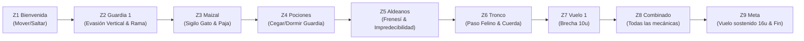

# Justificación de Cambios de Mecánicas — Nivel 1 (Tutorial)

**Proyecto:** Brujas de Salem  
**Motor:** Unity 6 (6000.3 LTS) — 2D URP  
**Documento:** Justificación de Cambios de Mecánicas del Nivel 1  
**Rama:** `feature/nivel1-tutorial-largo`  

---

## 1. Contexto del Rediseño

El Nivel 1 fue inicialmente concebido en el Game Design Document (GDD) como un prototipo vertical de sigilo tradicional. Sin embargo, al extender la escala del nivel a un tutorial guiado de **~232 unidades de longitud distribuidas en 9 zonas progresivas**, el diseño original requirió pivotes clave en mecánicas fundamentales para garantizar una curva de aprendizaje justa, educativa y atractiva para el jugador, eliminando la frustración innecesaria sin sacrificar el reto.

---

## 2. Matriz de Cambios de Mecánicas

| # | Mecánica del GDD | Cambio realizado | Justificación |
|---|---|---|---|
| **1** | **Vida del jugador:** Muerte instantánea por captura o caída al vacío. | **Sistema de 3 corazones** con daño fraccionado (1 corazón por contacto o caída) y **2 segundos de invulnerabilidad temporal** con parpadeo visual a 8 Hz. | Un nivel tutorial extenso (~232 u) con muerte de un solo golpe desincentiva la experimentación y genera fatiga extrema. El sistema de corazones otorga margen de error y feedback pedagógico inmediato ante fallos. |
| **2** | **Reaparición (Respawn):** Reinicio total del nivel al inicio desde x=0. | **8 Checkpoints distribuidos por zona** con reaparición segura en el último farol activado y persistencia de ítems ya recogidos. | Reduce el *backtracking* forzado y divide el aprendizaje en hitos independientes. Si el jugador comete un error en la zona 8, no debe rehacer los primeros 180 metros de tutorial ya dominados. |
| **3** | **Detección y Sigilo:** Sigilo binario y punitivo sin escapatoria una vez avistado. | **Opciones dinámicas de escape:** uso de pociones arrojables defensivas, reacción de frenesí en aldeanos con tiempo de cooldown y posibilidad de apaciguarlos en forma de gato. | Transforma el error de una sentencia de muerte en una oportunidad de pensamiento táctico rápido, permitiendo al jugador reaccionar activamente con las herramientas mágicas enseñadas. |
| **4** | **Vuelo y Escoba:** Escoba mágica disponible desde el inicio del nivel. | **Desbloqueo progresivo por recolección:** la bruja debe encontrar las 3 piezas (Rama en Z2, Paja en Z3 y Cuerda en Z6) para ensamblar la escoba y activar el vuelo. | Establece un *gatekeeping* narrativo y de diseño orgánico. Impide que el jugador vuele sobre los primeros retos de sigilo y otorga una recompensa triunfal justo antes de las grandes brechas de Z7 y Z9. |
| **5** | **Hechizos / Pociones:** Hechizos mágicos abstractos con cargas ilimitadas. | **Pociones tácticas consumibles** como pickups en frascos (Dormir, Cegar, Hipnotizar) con selector numérico (1, 2, 3), arco parabólico y salpicadura en área. | Fomenta la gestión consciente de recursos limitados, obligando al jugador a evaluar cuándo usar una poción para resolver un bloqueo (como en Z4) o guardar reservas para el reto combinado (Z8). |
| **6** | **Comportamiento de Aldeanos:** Aldeanos con rutas de patrulla idénticas a los guardias. | **Inteligencia artificial diferenciada:** movimiento errático (3 patrones aleatorios), detección visual humana, grito de alerta y **ataque en frenesí** con cooldown si la bruja no huye o se transforma. | Evita la monotonía en la aldea, aporta variedad de retos (los guardias son predecibles y letales; los aldeanos son impredecibles y ruidosos) y refuerza el valor de la forma felina para pasar desapercibida. |

---

## 3. Estructura Didáctica de las 9 Zonas

Cada zona del nivel rediseñado aísla y refuerza un concepto antes de combinarlo:

1. **Zona 1 (x: 0–24):** Bienvenida. Enseñanza básica de movimiento horizontal (`{Mover}`) y salto (`{Saltar}`) sin presión de enemigos. Primer punto de control (CP1) en x=22.
2. **Zona 2 (x: 24–48):** Salto y guardia. Introducción al cono de visión y patrulla lineal. Obstáculos altos y plataforma con la Rama de la escoba a y=2.8u (altura máxima del salto humano). Pista visual de la saliente inalcanzable a pie a y=5.2u con destellos. CP2 en x=46.
3. **Zona 3 (x: 48–72):** Escondite en maizal. Uso de `{Transformar}` para ocultarse en maizales donde el guardia patrullero no detecta a la bruja. Recolección de la Paja en x=56 y corazón en plataforma. CP3 en x=70.
4. **Zona 4 (x: 72–98):** Pociones contra guardia. Recolección de frascos de dormir y cegar. Paso estrecho bloqueado por un guardia donde no hay ruta alternativa superior ni maizal: exige neutralizar al guardia con una poción arrojable (`{ElegirPoción}` y `{LanzarPoción}`). CP4 en x=96.
5. **Zona 5 (x: 98–126):** Aldeanos coloniales. 4 aldeanos con rutas erráticas. Si avistan a la bruja en forma humana, gritan y entran en frenesí. Transición a gato o escape hasta que se calmen. CP5 en x=124.
6. **Zona 6 (x: 126–152):** Pasaje felino. Tronco hueco con apertura libre de 1.05u. El collider humano (1.60u) choca contra el tronco; el gato (0.50u) cruza holgadamente. En el interior se encuentra la Cuerda (3/3), completando la escoba y desbloqueando el vuelo. CP6 en x=150.
7. **Zona 7 (x: 152–180):** Primer reto de vuelo. Brecha de 10 unidades sobre el abismo. El salto humano (4.75u máx) es insuficiente; el vuelo (20.4u de autonomía) permite cruzar con soltura. Repisas elevadas con premios. CP7 en x=178.
8. **Zona 8 (x: 180–206):** Reto combinado. Síntesis de todos los sistemas: guardias, aldeanos, maizales, plataformas sobre desniveles y gestión de pociones. CP8 en x=204.
9. **Zona 9 (x: 206–232):** Vuelo final y meta. Gran brecha de 16 unidades sobre el abismo con una isla de descanso en x=216 para recargar energía de vuelo antes de alcanzar el portón final (`LevelGoal`) en x=228.
