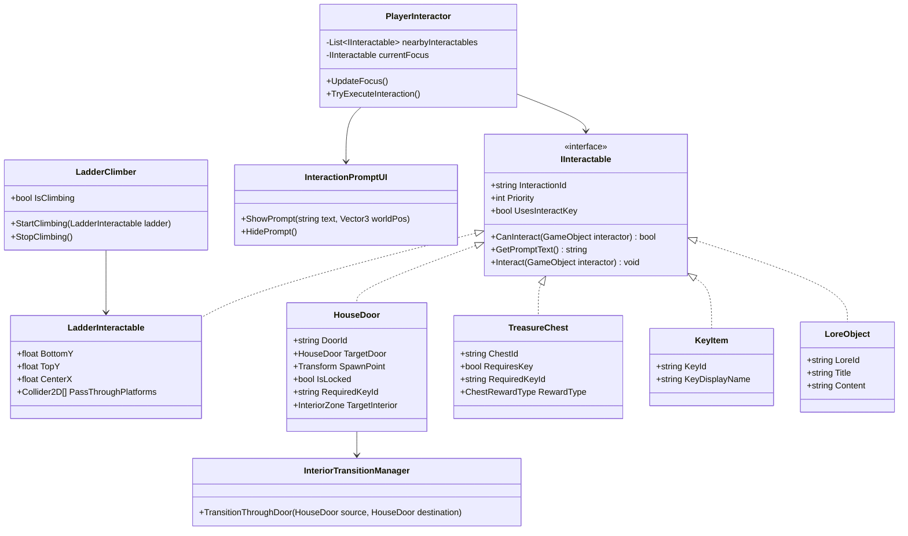

# AUDITORÍA TÉCNICA Y DISEÑO DE ARQUITECTURA — NIVEL 2: ALDEA EXPLORABLE DEL SIGLO XVII

**Proyecto:** `DV_Brujas_De_Salem`  
**Rama Activa:** `feature/nivel2-dia`  
**Escena Objetivo:** `Assets/Scenes/Level2.unity`  
**Motor:** Unity 6 (6000.3 LTS) — URP 2D  

---

## 1. AUDITORÍA TÉCNICA DEL PROYECTO EXISTENTE (FASE 1)

### 1.1 Controlador de Personaje y Físicas (`Witch`)
- **Controlador Principal:** [`PlayerController.cs`](../Assets/Scripts/Player/PlayerController.cs) sobre el objeto `Witch` (`Rigidbody2D` Dinámico, Interpolate, Continuous, FreezeRotation, `BoxCollider2D` con material sin fricción).
  - **Movimiento Horizontal:** `moveSpeed = 6.0 u/s`, aceleración `45 u/s²`, desaceleración `55 u/s²`, control en aire `0.85`.
  - **Salto:** Altura variable hasta `jumpHeight = 2.8 u`, `coyoteTime = 0.1 s`, `jumpBufferTime = 0.1 s`, `fallGravityMultiplier = 1.5`.
  - **Detección de Suelo:** `Physics2D.OverlapBox` bajo la base del `BoxCollider2D` filtrando por `groundMask` (capa `Ground`).
  - **Vuelo:** Soportado mediante `CanFly` (habilitado en Nivel 2 por [`Level2BroomGrant.cs`](../Assets/Scripts/Level2/Level2BroomGrant.cs)) con tecla `F`.
- **Transformación Felina:** [`TransformationManager.cs`](../Assets/Scripts/Player/TransformationManager.cs) alterna con `T` entre forma humana (`0.6 x 1.6 u`) y forma de gato (`0.8 x 0.5 u`, velocidad `1.3x`), validando espacio vertical con `HasRoomForHuman`.
- **Animaciones:** [`WitchRigAnimator.cs`](../Assets/Scripts/Player/Rig/WitchRigAnimator.cs) anima proceduralmente los 21 huesos del rig en función de `body.linearVelocity`, `player.IsGrounded` y `player.IsFlying`, además de `Animator` para la forma de gato ([`CatAnimationDriver.cs`](../Assets/Scripts/Player/CatAnimationDriver.cs)).

### 1.2 Cámara y Límites (`Main Camera`)
- **Componente:** [`CameraFollow.cs`](../Assets/Scripts/Core/CameraFollow.cs).
- **Funcionamiento:** Seguimiento suave con anticipación horizontal (`lookAhead = 1.8 u`), zona muerta vertical (`verticalDeadZone = 2.2 u`), encuadre restringido por rectángulo `minLimit` y `maxLimit` (`useLimits = true`) y método `SnapToTarget()` para cambios instantáneos de zona sin barridos bruscos.

### 1.3 Salud, Inventarios, HUD y Estado Global
- **Estado Global y Temporizador:** [`GameManager.cs`](../Assets/Scripts/Core/GameManager.cs) administra vidas (`Lives`, máx. 3), tiempo (`TimeElapsed`), puntaje (`Score`) y cargas de pociones (`BlindCharges`, `HypnotizeCharges`, `SleepCharges`).
- **Lanzamiento de Pociones:** [`PotionInventory.cs`](../Assets/Scripts/Player/PotionInventory.cs) selecciona pociones con `1, 2, 3` y lanza con `E`, `Q` o clic izquierdo.
- **Inventario del Nivel 2:** [`IngredientInventory.cs`](../Assets/Scripts/Level2/IngredientInventory.cs) gestiona los 4 tipos de ingredientes (Hongos, Arañas, Flores Marchitas y Raíces; 8 requeridos, 10 disponibles) y persiste en sesión con prefijo `L2_`.
- **Interfaz HUD:** [`HUDController.cs`](../Assets/Scripts/UI/HUDController.cs) y [`IngredientHUD.cs`](../Assets/Scripts/Level2/IngredientHUD.cs) muestran corazones, barras de energía, pociones, ingredientes, puntaje, reloj y mensajes contextuales.

### 1.4 Reglas de Reutilización y Protección del Nivel 1
- **Archivos Protegidos Intactos:** `Assets/Scenes/Level1.unity`, `Assets/Scenes/Level1_Backup.unity`, prefabs de `Assets/Prefabs/` (raíz) y scripts en `Core/`, `Player/`, `Enemies/`, `Level/` y `UI/` no se modifican.
- **Ampliación Modular en `Assets/Scripts/Level2/`:** Todas las mecánicas nuevas de escalada, interacción contextual, puertas, interiores, cofres, llaves y secretos se implementan como componentes modulares dentro del espacio de nombres `Level2`, acoplados limpiamente sobre `Witch` y `Level2.unity`.

---

## 2. ARQUITECTURA DE INTERACCIÓN Y EXPLORACIÓN (FASE 4 Y FASE 5)

### 2.1 Coordinación de Entrada (`E` para Interactuar vs Lanzar Poción)
- `PotionInventory` escucha `KeyCode.E` para lanzar pociones.
- Cuando `PlayerInteractor` detecta que el jugador está en el rango de un `IInteractable` activo que usa la tecla `E` (`UsesInteractKey == true`, como puertas, cofres, llaves o grimorios), `PlayerInteractor` suspende temporalmente el disparo en `PotionInventory` mientras dure el foco de interacción (manteniendo activas las teclas `1`, `2`, `3` para cambiar de poción) y lo reactiva de inmediato al alejarse.
- De esta forma, pulsar `E` frente a una puerta o cofre ejecuta exclusivamente la acción contextual sin desperdiciar pociones ni mostrar avisos de falta de cargas.

### 2.2 Sistema de Escalada Vertical (`LadderClimber` + `LadderInteractable`)
- Se ejecuta con `[DefaultExecutionOrder(50)]` sobre `Witch` para coordinarse con `PlayerController` sin modificar su código fuente.
- Al iniciar la escalada (`W / ↑` en el cuerpo de la escalera o `S / ↓` desde la plataforma superior):
  - Pone `rb.gravityScale = 0f` exclusivamente durante el estado `IsClimbing` y centra suavemente la posición X de la bruja en el eje de la escalera.
  - Desactiva temporalmente la colisión (`Physics2D.IgnoreCollision`) **únicamente** entre el `BoxCollider2D` de la bruja y las plataformas `PlatformEffector2D` asociadas a esa escalera, permitiendo atravesar el forjado del piso superior tanto al subir como al bajar sin desactivar las colisiones globales.
  - Permite detenerse en cualquier peldaño (`linearVelocity = Vector2.zero` sin deslizamiento), cambiar de dirección, saltar fuera de la escalera con `Espacio` o salir automáticamente al coronar el extremo superior o tocar el suelo inferior, restaurando `rb.gravityScale` y las colisiones de plataforma.

### 2.3 Sistema de Casas, Interiores y Cámara (`HouseDoor` + `InteriorTransitionManager`)
- Los interiores están construidos dentro de `Level2.unity` bajo `Environment/Interiors/` en coordenadas espacialmente aisladas (`y = 28..45`), lo que garantiza:
  - Conservación total del estado de la bruja, vida, temporizador de `GameManager`, `IngredientInventory`, `PotionInventory`, `KeyInventory` y enemigos del exterior.
  - Transición suave con fundido visual breve (`0.2s`), posicionamiento exacto en el `SpawnPoint` de destino, conservación de la orientación y actualización automática de los límites de `CameraFollow` (`minLimit` / `maxLimit` + `SnapToTarget()`) para encuadrar el interior de varios pisos o devolver los límites completos de la aldea al salir al exterior.

---

## 3. DISEÑO DE NIVEL Y DISTRIBUCIÓN DE LA ALDEA (FASE 2, 3, 9 Y 10)

### 3.1 Mapa General por Zonas y Rutas
| Zona | Rango X (Exterior) | Edificios y Verticalidad Exterior | Casas Explorables e Interiores | Secretos y Recompensas |
|---|---|---|---|---|
| **Zona 1: Entrada a la Aldea** | `0 .. 28 u` | Fachada de la Botica con balcón en 2º piso (`y = 3.8 u`), escalera exterior (`x = 10.2 u`) y pasarela hacia toldos. | **Casa 1: Botica de Herbolaria** (2 pisos: Planta Baja de Alquimia + 2º Piso Dormitorio con salida al balcón exterior). | **Cofre de la Botica** (Poción de Ceguera + 150 pts), Recetario de Salem (`Examinar`), salida elevada al balcón para alcanzar el Hongo Z1. |
| **Zona 2: Calle de Artesanos y Posada** | `28 .. 60 u` | Fachadas coloniales con balcones (`y = 3.8 u`), escaleras de mano (`x = 32.2 u`, `x = 51.8 u`) y pasarelas aéreas entre tejados (`y = 3.8 .. 5.2 u`). | **Casa 2: Posada del Cuervo** (3 niveles: Sótano de Piedra + Planta Baja con Chimenea + 2º Piso con salida a pasarela alta). | **Llave de Hierro de la Posada** oculta en el sótano; **Cofre Cerrado con Llave** en el 2º piso (Poción de Sueño + Corazón + 250 pts); Diario del Posadero. |
| **Zona 3: Plaza del Canal** | `60 .. 95 u` | Puente de carretas sobre el canal (`x = 78 u`), plataformas de vigas (`y = 4.0 .. 5.6 u`) y escalera hacia mirador alto (`x = 63.2 u`, `x = 89.2 u`). | Miradores elevados y plataformas conectadas sobre el canal para esquivar guardias por arriba. | Ruta aérea sobre el canal con Corazón y Flor Marchita; cofre oculto en el mirador del canal (`x = 71 u, y = 4.5 u`). |
| **Zona 4: Callejón y Casa Abandonada** | `95 .. 125 u` | Callejón con túnel felino (`y = 1.05 u`), fachada de la Casa Abandonada con puerta en calle (`x = 102.2 u`) y puerta/balcón en tejado (`x = 115.2 u, y = 4.4 u`). | **Casa 3: Casa del Tejedor Abandonada** (3 niveles: Planta Baja + 2º Piso con balcón al tejado + **Ático Secreto** bajo el tejado). | **Ruta Alternativa Interior** para cruzar sobre el callejón; **Ático Secreto** con Cofre Arcano (Poción de Hipnosis + 300 pts) y Grimorio Oculto. |
| **Zona 5: Gran Mercado y Mansión** | `125 .. 165 u` | Gran plaza multinivel (`y = 0.17 .. 6.2 u`), escaleras de madera a las pasarelas altas (`x = 133.2 u`, `x = 152.8 u`) y balcón señorial. | **Casa 4: Mansión del Magistrado** (3 niveles: Sótano de Archivos + Gran Salón + Galería/Biblioteca en 2º piso con salida al balcón alto). | **Llave del Magistrado** en el sótano tras salto de plataformas; **Cofre Real del Magistrado** en 2º piso (Corazón + Poción + 400 pts); Actas del Juicio. |
| **Zona 6: Portón de la Iglesia** | `165 .. 190 u` | Guardia del portón, Caseta de Guardia con puerta cerrada por misión (se desbloquea al reunir los 8 ingredientes o con llave maestra), `IngredientGate` y `Level2Goal`. | **Caseta del Guardián** (Puerta sellada por misión de ingredientes, con recompensa final de bonificación antes de cruzar la meta). | Bonificación de exploración completa antes de cruzar hacia el Acto 3. |

---

## 4. HERRAMIENTAS DE CONSTRUCCIÓN Y VERIFICACIÓN AUTOMATIZADA (FASE 11)

- **Constructor de Aldea e Interiores (`Level2VillageBuilder.cs`)**:
  - Menú: `Brujas/Nivel 2/Construir Aldea Explorable e Interiores (Siglo XVII)`
  - Reconstruye de forma idempotente todas las fachadas coloniales, balcones, escaleras exteriores, puertas y los 4 interiores multinivel en `Assets/Scenes/Level2.unity`.
- **Verificador de Exploración e Interiores (`Level2ExplorationVerifier.cs`)**:
  - Menú: `Brujas/Nivel 2/4. Verificar Aldea Explorable e Interiores (20 Pruebas Fase 11)`
  - Resultado verificado: **20/20 pruebas superadas (`allPassed = true`)**.
- **Verificador Maestro del Nivel 2 (`Level2MasterVerifier.cs`)**:
  - Menú: `Brujas/Nivel 2/1. Verificación Master Nivel 2 (10 Hitos)`
  - Resultado verificado: **10/10 hitos superados (`allPassed = true`)**.

